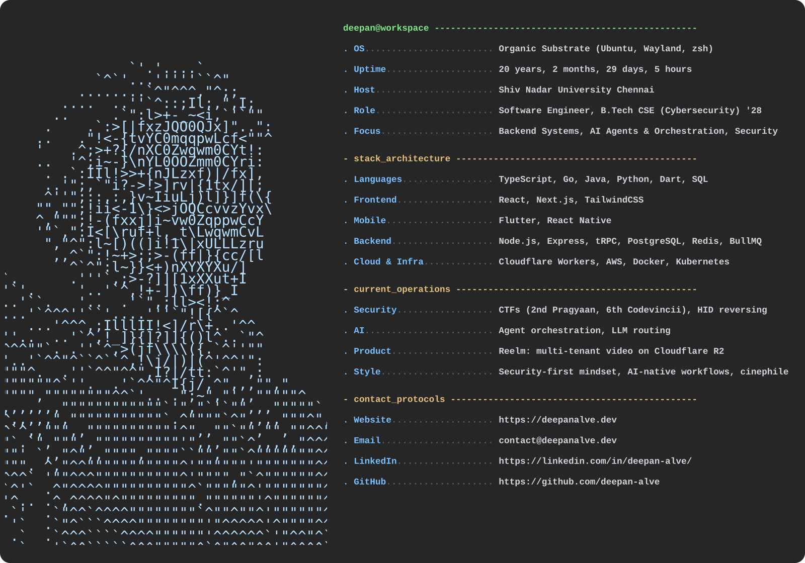
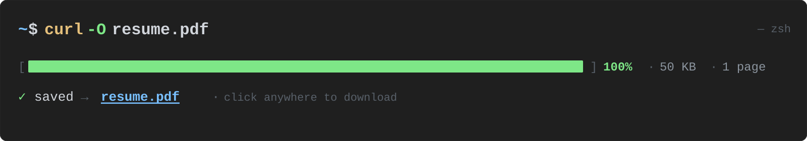
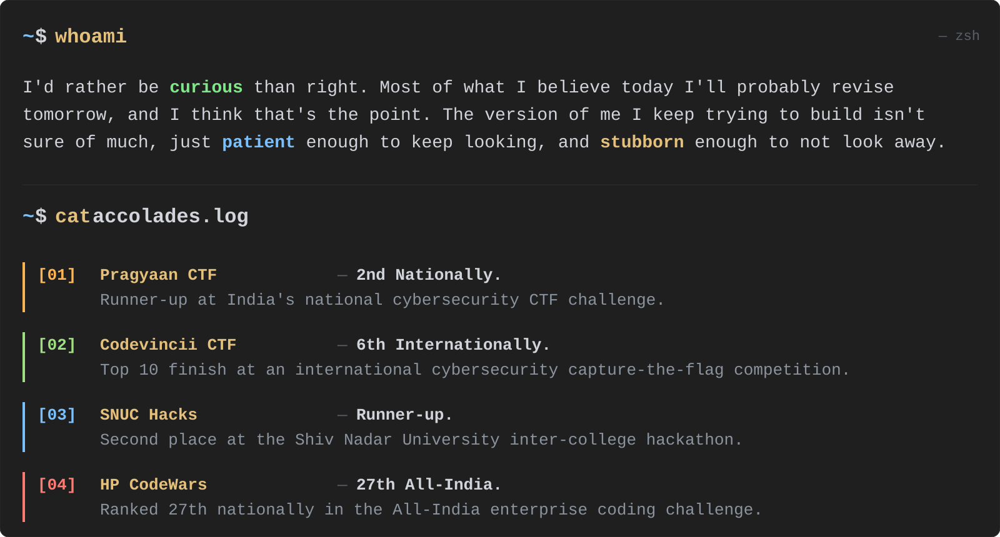

  

  

  

## Deepan Alve

CS student in Chennai. I build things that ship, and break things that shouldn't.

[Portfolio](https://www.deepanalve.dev) · [Blog](https://blog.deepanalve.dev) · [LinkedIn](https://www.linkedin.com/in/deepanalve/) · [Resume](https://resume.deepanalve.dev) · contact@deepanalve.dev

### Worth a look

- **[Win-my-Argument](https://github.com/deepan-alve/Win-my-Argument):** AI debate assistant built on Perplexica
- **[reelm-player](https://github.com/deepan-alve/reelm-player):** embeddable web component for adaptive video
- **[womier-l65](https://github.com/deepan-alve/womier-l65):** Womier L65 keyboard support on Linux
- **[screenshot-pro](https://github.com/deepan-alve/screenshot-pro):** drag-to-capture screenshots for GNOME Shell
- **[Stacked](https://github.com/deepan-alve/Stacked):** self-hosted tracker for movies, shows, anime and books

### Wins

- **2nd nationally:** Pragyaan CTF
- **6th internationally:** Codevincii CTF
- **Runner-up:** SNUC Hacks
