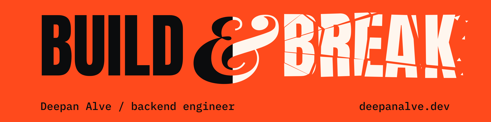

  

  

  

  

  <a href="https://www.deepanalve.dev">Portfolio</a> &nbsp;·&nbsp;
  <a href="https://blog.deepanalve.dev">Blog</a> &nbsp;·&nbsp;
  <a href="https://www.linkedin.com/in/deepan-alve/">LinkedIn</a> &nbsp;·&nbsp;
  <a href="https://resume.deepanalve.dev">Resume</a> &nbsp;·&nbsp;
  <a href="mailto:contact@deepanalve.dev">contact@deepanalve.dev</a>

